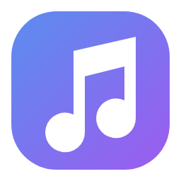
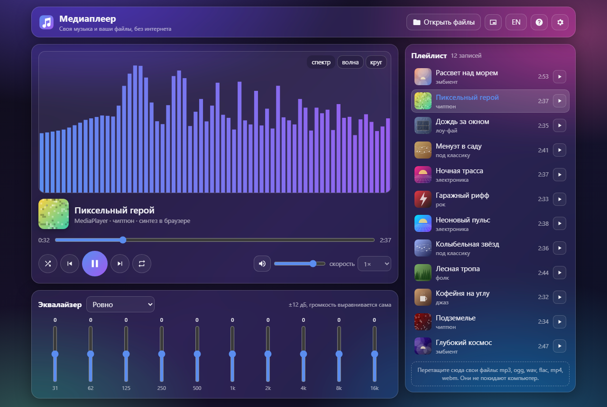
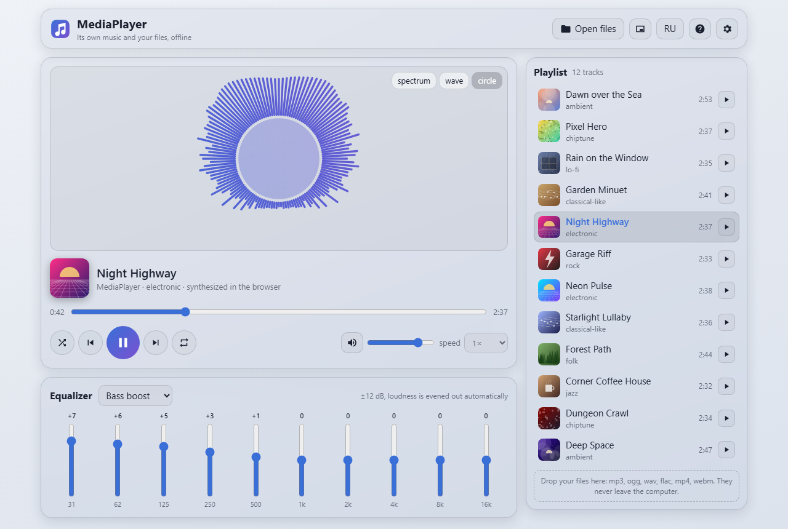
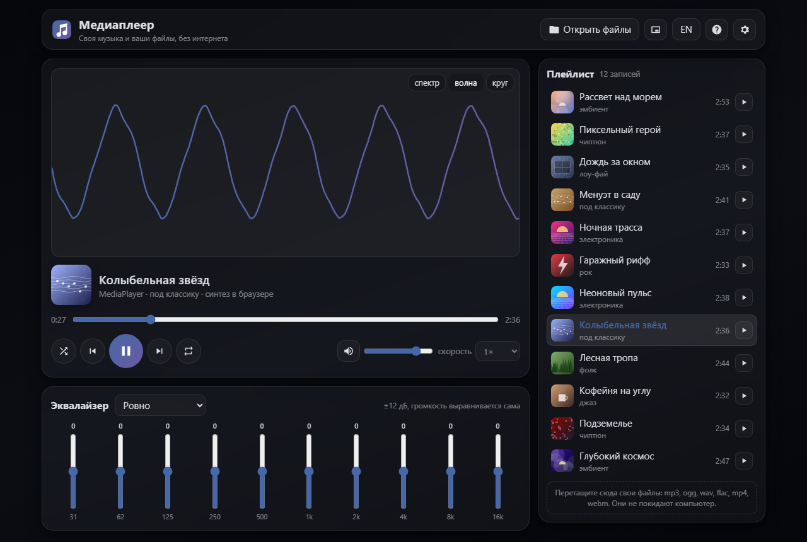

<div align="center">



# Медиаплеер

**Медиаплеер (MediaPlayer) - плеер музыки и видео в одной HTML-странице. В нём свой альбом из 12 мелодий, которые вовсе не файлы: небольшой генератор песен пишет каждую партитуру (мелодия, аккорды, бас, ударные), а браузер играет её через Web Audio. Работает без сервера и без интернета: откройте `index.html`, пользуйтесь на сайте или поставьте программу для Windows.**

[**▶ Открыть на сайте →**](https://alexalesha.github.io/MediaPlayer/) &nbsp;·&nbsp; [Скачать для Windows](https://github.com/ALEXalesha/MediaPlayer/releases/latest) &nbsp;·&nbsp; [English version of this file](README.md)

[](#) [](https://github.com/ALEXalesha/MediaPlayer/releases/latest) [](https://github.com/ALEXalesha/MediaPlayer/actions/workflows/ci.yml) [](LICENSE) [](https://developer.mozilla.org/docs/Web/HTML) [](https://www.electronjs.org/) [](https://alexalesha.github.io/MediaPlayer/) [](https://claude.com/claude-code)

Код, тесты и документация этого проекта написаны Claude (Anthropic) в Claude Code. Идеи, проверка и решения - Алексей.

</div>

Интерфейс на русском и английском (кнопка RU/EN в шапке).





## Что умеет

- **Свой альбом:** 12 мелодий разных жанров (эмбиент, чиптюн, лоу-фай, под классику, электроника, рок, фолк, джаз), по 2,5-4 минуты, у каждой название на двух языках и нарисованная обложка. Одна и та же мелодия всегда звучит одинаково: генератор берёт зерно из имени песни.
- **Ваши файлы:** кнопка «Открыть файлы» или перетаскивание в окно - mp3, ogg, opus, wav, flac, m4a, aac, mp4, webm. Файлы никуда не уходят с компьютера. Видео показывается вместо визуализации. Битый файл получает пометку в своей строке, плеер идёт дальше.
- **Плейлист:** щелчок по строке включает её, порядок меняется перетаскиванием или Alt+стрелками (и запоминается), перемешивание (каждая песня по разу, пока не пройдены все), повтор всех / одной / без повтора, скорость 0,5-2×.
- **Эквалайзер:** 10 полос (31 Гц - 16 кГц), ±12 дБ, пресеты; предусилитель снижает уровень, чтобы подъём полос не давал перегруза.
- **Визуализация:** спектр, волна или круг; мини-режим только с самым нужным.
- **Мультимедийные клавиши:** название, исполнитель, альбом и обложка уходят в Media Session, поэтому плеером управляют клавиши клавиатуры и панель системы.
- **Память:** громкость, эквалайзер, скорость, вид, повтор, текущая песня и позиция (и в ваших файлах) переживают перезагрузку (`localStorage`, ключи `mplayer:*`); если хранилище закрыто, страница всё равно работает.
- **Вид:** пять тем (Стеклянная, Строгая, Светлая, Ночная, Тёплая - те же, что в Paint Pro), работает на телефоне.



### Клавиши

| Клавиша | Действие |
|---|---|
| Пробел | играть / пауза |
| ← / → | на 5 с назад / вперёд (с Shift - на 30 с) |
| ↑ / ↓ | громкость |
| M | без звука |
| N / P | следующая / предыдущая |

## Запуск у себя

- **Браузер:** откройте `index.html` в Chrome, Edge или Firefox. Всё внутри файла, ничего не скачивается.
- **Программа для Windows:** `MediaPlayer-<версия>-Setup.exe` (ставится для текущего пользователя) или `MediaPlayer-<версия>-Portable.exe` (без установки) в [Releases](https://github.com/ALEXalesha/MediaPlayer/releases). Окно помнит размер и место, версия - в заголовке.
- **Из исходников:** `npm install`, потом `npm start` (программа) или `npm run dist` (установщик и portable в `electron/dist`).

Программа в `electron/` открывает тот же `index.html` - второй копии страницы нет.

## Проверки

```
npm install
npx playwright install chromium
npm test                       # законы страницы и программа Electron (окно скрыто и молчит)
node tests/mutate.js           # проверка проверок: сломанные копии страницы должны ронять законы
```

Законы открывают `index.html` по файловому адресу в безголовом Chromium с выключенным звуком. Музыка проверяется без колонок: каждая мелодия считается через `OfflineAudioContext`, и замеряются сами отсчёты - не тишина, нет перегруза, нет провалов, звук кончается вместе с партитурой. Проверяется и партитура: ноты в ладу песни, ни одно окно из 4 тактов не повторяется, не больше 3 одинаковых нот подряд, повтор части - не копия. Полоса прокрутки плейлиста проверяется в двух видах Chromium - классическая и поверх содержимого (Chrome в Windows 11, macOS) - на 12 размерах окна и пяти темах: она не заходит на кнопки строк, зазор не меньше 4 px. Ни у одного элемента с кнопками нет backdrop-filter ни в одной теме (на видеокарте он давал светлую полосу через панель при наведении на кнопку), и наведение на кнопку меняет только её. Стрелки на ползунке громкости или полосе эквалайзера двигают сам ползунок, рамку фокуса строки плейлиста не срезает край списка, у каждой кнопки-значка без подписи есть подсказка (находки независимой проверки 1.0.3). Мутационный скрипт по одному ломает 20 правил (перемешивание, предусилитель, частоты полос, повтор, скорость, память, правила мелодии, место под наложенную полосу прокрутки и другие) в копии во временной папке и не трогает `index.html`. Кадры выше сняты без окна скриптом `tools/screenshots.js`.

## История

Медиаплеер сделан в сборнике [Hub](https://github.com/ALEXalesha/ALEXalesha.github.io) (папка `web/media-player`), где он - программа в разделе «Программы» Хаба. Этот репозиторий несёт его вместе с историей коммитов.

## Лицензия

MIT, см. [LICENSE](LICENSE). Мелодии создаёт код этой страницы, на них та же лицензия.
